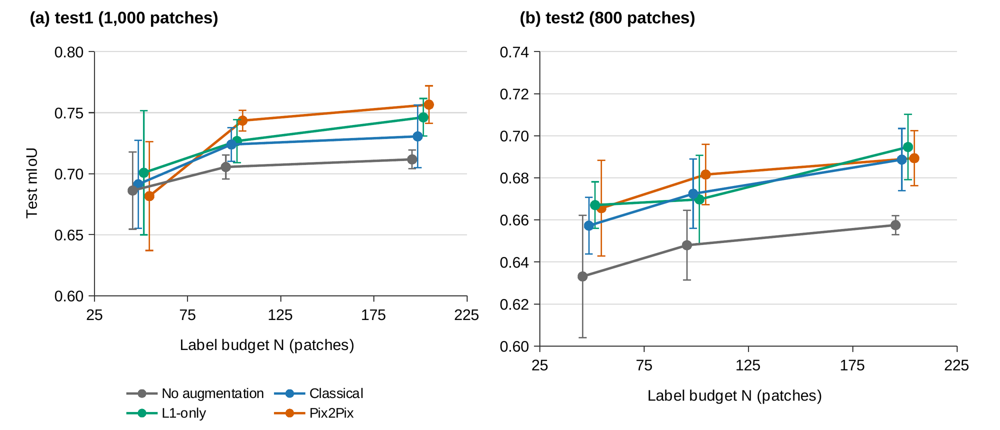
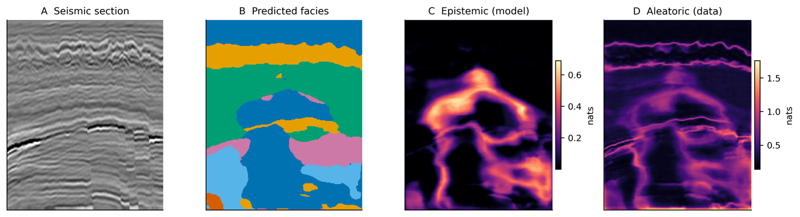
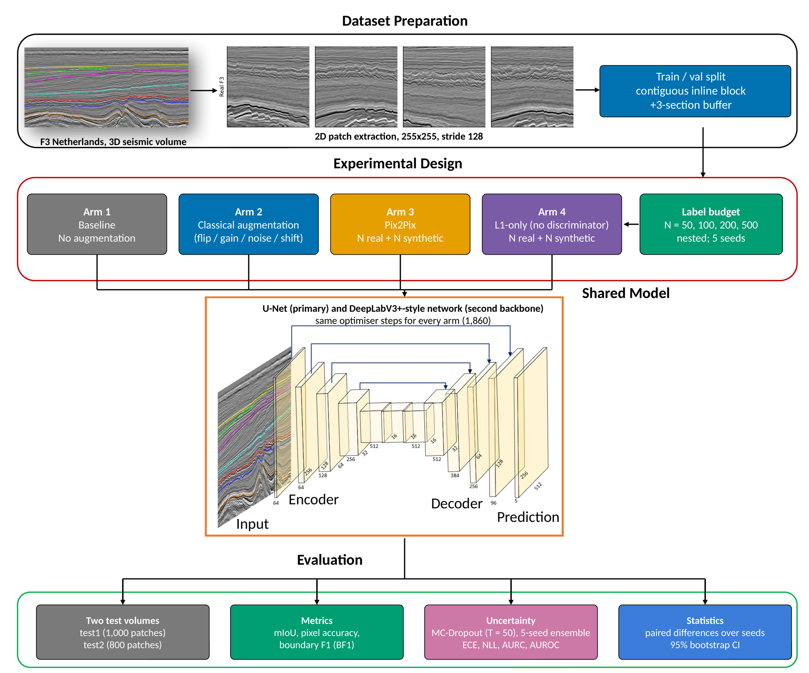
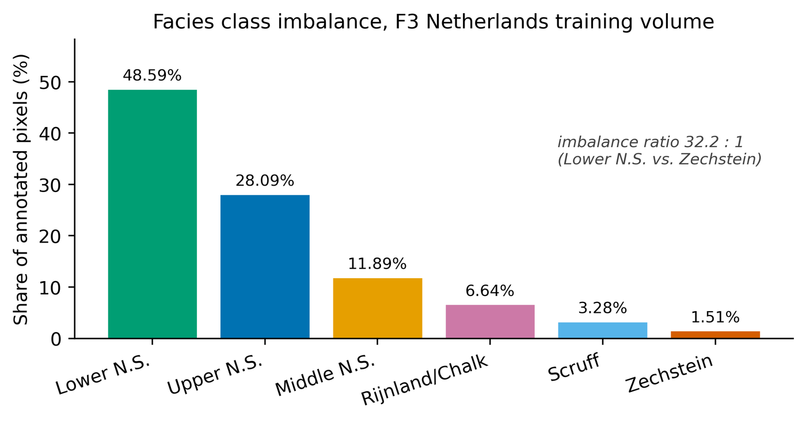
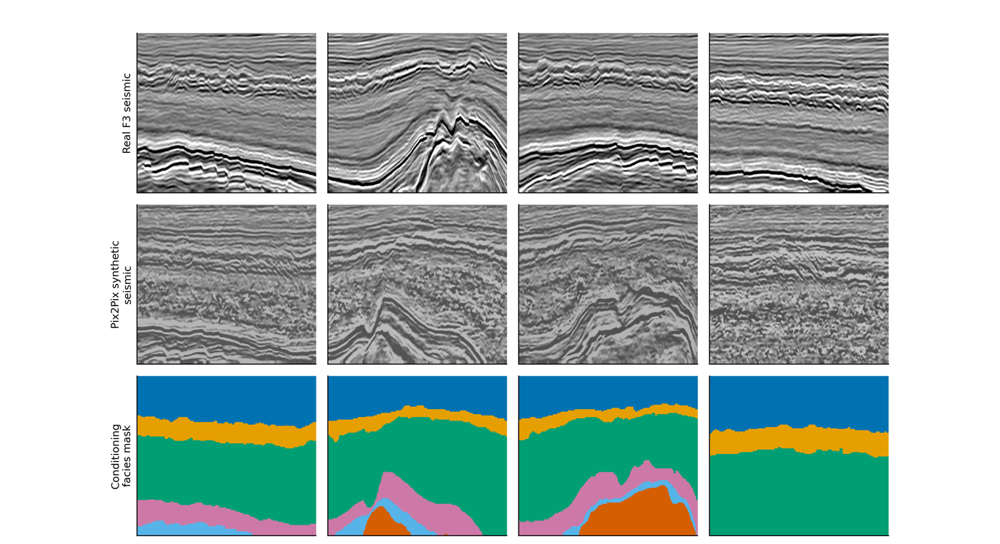

# GeoSEG — Is Seismic Facies Segmentation Actually Label-Limited?

**A reproducible benchmark testing whether generative AI relieves a labelling bottleneck in geoscience image segmentation, or whether it doesn't need to.**

[](LICENSE)
[](https://www.python.org/)
[](https://pytorch.org/)

This repository accompanies the book chapter *"Generative AI for Image Segmentation in Subsurface Reservoir Characterization: A Reproducible Benchmark of Data Scarcity, Synthetic Augmentation, and Uncertainty on the F3 Netherlands Dataset"* (Al-Fakih, 2026).

Generative AI is widely proposed as a fix for the scarcity of expert-annotated data in geoscience segmentation. This repository tests that claim directly, rather than assuming it, with a fixed U-Net backbone, a matched-training-set-size control, and an uncertainty decomposition — all applied to the same public benchmark so the numbers are comparable to each other, not just to a baseline.

---

## Key findings

<p align="center">
  
</p>

- **The real-label learning curve is nearly flat.** A ten-fold increase in labelled patches (50 → 500) raises test mIoU by only 5.8 points. Adjacent seismic inlines are highly redundant — F3 Netherlands is not, in practice, a severely label-starved problem beyond a modest annotation budget.
- **A synthetic patch is worth measurably less than a real one at low label budgets.** At matched total training-set size, Pix2Pix-augmented training underperforms an equal-size real-only training set by −0.042 mIoU at N=50, narrowing at higher budgets. The shortfall is directly explained by discriminator saturation, visible in the adversarial training logs (D-loss → 0.000 by epoch 100 in every run).
- **Epistemic uncertainty is roughly an order of magnitude smaller than aleatoric uncertainty**, across every facies class. The segmentation ceiling on this dataset is set predominantly by seismic resolution and noise, not by training-data volume — which mechanistically explains the flat learning curve rather than merely accompanying it.

<p align="center">
  
  <br><em>Epistemic uncertainty (panel C) concentrates at one structurally anomalous facies intrusion, not at ordinary boundaries generically; aleatoric uncertainty (panel D) tracks every boundary in the section.</em>
</p>

**The value of this repository is the protocol, not the numbers.** The specific mIoU values are dataset- and architecture-specific. The matched-size control and the uncertainty decomposition are cheap, reusable diagnostics that let you check whether *your* segmentation problem is data-limited or physically limited before you invest in a synthetic-data pipeline.

---

## What's in this repository

```
GeoSEG/
├── geoseg/                      # Core package
│   ├── config.py                 # All paths, hyperparameters, experiment grid
│   ├── data.py                   # F3 loading, patch extraction, axis auto-detection
│   ├── models.py                 # U-Net backbone + Pix2Pix generator/discriminator
│   ├── augment.py                # Classical (physics-constrained) augmentation
│   ├── train.py                  # Training/evaluation engine
│   └── metrics.py                # IoU, Dice, Boundary F1, calibration, entropy decomposition
├── scripts/
│   ├── 00_prepare_data.py        # Verify F3 volumes, cache patches, class balance
│   ├── 01_fig2_class_imbalance.py
│   ├── 02_train_pix2pix.py       # One generator per (budget, seed) — no leakage
│   ├── 03_run_experiment_a.py    # 36-run sweep: arm × budget × seed
│   ├── 04_run_experiment_b.py    # MC-Dropout uncertainty decomposition
│   ├── 05_make_figures.py        # Learning curve, calibration, uncertainty figures
│   ├── 06_diagnostics.py         # Matched-size control, effect-size-vs-noise table
│   ├── 07_real_seismic_figures.py # Real seismic panels from your own cached data
│   └── run_when_free.py          # Queues the sweep for whenever the GPU is free
├── docs/images/                  # Figures used in this README and the chapter
└── manuscript/                   # The chapter itself (this repo's paper)
```

<p align="center">
  
</p>

---

## Quickstart

```bash
git clone https://github.com/ARhaman/GeoSEG.git
cd GeoSEG
conda create -n geoseg python=3.11 -y
conda activate geoseg
pip install torch --index-url https://download.pytorch.org/whl/cu124
pip install numpy scipy matplotlib
```

**Get the data.** F3 Netherlands is third-party data and is **not** redistributed in this repository. Download it from the [Alaudah et al. (2019) benchmark release](https://github.com/yalaudah/facies_classification_benchmark) and point `DATA_ROOT` in `geoseg/config.py` at the extracted `train/` and `test_once/` folders.

**Run the pipeline in order:**

```bash
python scripts/00_prepare_data.py          # ~10-15 min, CPU/disk only
python scripts/01_fig2_class_imbalance.py  # seconds

python scripts/02_train_pix2pix.py         # ~13 h on an RTX 4500 Ada (12 generators)
python scripts/03_run_experiment_a.py      # ~11 h (36 U-Net runs)
python scripts/04_run_experiment_b.py --arm classical --budget 500 --seed 0
python scripts/05_make_figures.py
python scripts/06_diagnostics.py
python scripts/07_real_seismic_figures.py  # real seismic panels from your own run
```

Every stage is resumable — steps 02 and 03 skip any `(arm, budget, seed)` configuration whose output already exists, so an interrupted sweep can restart where it left off. If you're sharing a GPU with another job, `scripts/run_when_free.py` polls `nvidia-smi` and starts the sweep automatically once enough VRAM is free.

<p align="center">
  
</p>

---

## Design choices that matter (and why)

These are the load-bearing methodological decisions behind every result in the chapter — implemented in code, not just asserted in prose:

| Choice | Why | Where |
|---|---|---|
| **Contiguous-block validation split**, not random patches | Adjacent F3 inlines are near-duplicates; a random split leaks validation data into training and inflates every number | `data.py: train_val_section_split` |
| **Lateral-flip-only augmentation**, never vertical | Seismic sections have a physical up-direction; vertical flips teach the network stratigraphy that violates superposition | `augment.py: ClassicalAug` |
| **One Pix2Pix generator per (budget, seed)** | A generator trained on 500 labels and reused for the 50-label arm would leak information the smaller budget isn't supposed to have | `scripts/02_train_pix2pix.py` |
| **Auto-detected patch-tiling axis per volume** | F3's `test2` volume is transposed relative to `train`/`test1` — tiling it along the wrong axis silently produces zero patches | `data.py: choose_axis` |
| **Matched-training-set-size control** | Comparing an augmented arm against a baseline at equal *label* budget (not equal *total training-set size*) systematically overstates synthetic data's value | `scripts/06_diagnostics.py` |
| **Entropy-based aleatoric/epistemic decomposition** | Total predictive entropy over T stochastic passes splits additively into mean per-pass entropy (aleatoric) and mutual information (epistemic) — this is what makes the uncertainty claims falsifiable rather than asserted | `metrics.py: decompose_uncertainty` |

<p align="center">
  
  <br><em>Real F3 seismic (top) vs. Pix2Pix-synthesised patches on the same conditioning masks (middle). The generator reproduces coherent reflectors in thin, homogeneous facies but breaks down into a spatially incoherent, mottled texture in thicker, heterogeneous facies — visible evidence of the discriminator saturation diagnosed in the chapter.</em>
</p>

---

## Results summary

Full results (mean ± SD across 3 seeds, 36 runs) are in the chapter's Table 1 and `manuscript/`. Headline numbers:

| Arm | N=50 | N=100 | N=200 | N=500 |
|---|---|---|---|---|
| No augmentation | 0.663 ± 0.013 | 0.709 ± 0.011 | 0.715 ± 0.014 | 0.721 ± 0.009 |
| Classical augmentation | 0.652 ± 0.028 | 0.716 ± 0.011 | 0.730 ± 0.007 | 0.733 ± 0.004 |
| Pix2Pix augmentation | 0.666 ± 0.048 | 0.706 ± 0.022 | 0.746 ± 0.014 | 0.737 ± 0.005 |

Uncertainty decomposition (MC-Dropout, N=50 passes, classical arm @ N=500):

| Component | Magnitude (nats, averaged over 6 facies) |
|---|---|
| Aleatoric (data) | 0.25 – 0.44 |
| Epistemic (model) | 0.001 – 0.09 |

Aleatoric uncertainty is roughly **10× larger** than epistemic uncertainty across every facies class.

---

## Citation

If you use this code or protocol, please cite:

```bibtex
@incollection{alfakih2026geoseg,
  title     = {Generative AI for Image Segmentation in Subsurface Reservoir
               Characterization: A Reproducible Benchmark of Data Scarcity,
               Synthetic Augmentation, and Uncertainty on the F3 Netherlands Dataset},
  author    = {Al-Fakih, Abdulrahman},
  booktitle = {Image Segmentation in the Geosciences: From Fundamentals to Frontiers},
  publisher = {Elsevier},
  year      = {2026}
}
```

Please also cite the underlying F3 benchmark:

```bibtex
@article{alaudah2019machine,
  title   = {A machine learning benchmark for facies classification},
  author  = {Alaudah, Yazeed and Micha{\l}owicz, Patrycja and Alfarraj, Motaz and Alregib, Ghassan},
  journal = {Interpretation},
  volume  = {7},
  number  = {3},
  pages   = {SE175--SE187},
  year    = {2019}
}
```

## License

Code in this repository is released under the [MIT License](LICENSE). The F3 Netherlands dataset is third-party data with its own license terms — see the [Alaudah et al. benchmark release](https://github.com/yalaudah/facies_classification_benchmark) for details. It is not redistributed here.

## Acknowledgments

*[Author to complete — institutional/funding/computational-resource acknowledgments.]*

## Contact

Abdulrahman Al-Fakih — [add contact email/affiliation]

Issues and pull requests welcome. If you run this protocol on a different basin, modality, or generative technique, I'd like to hear what you find.
