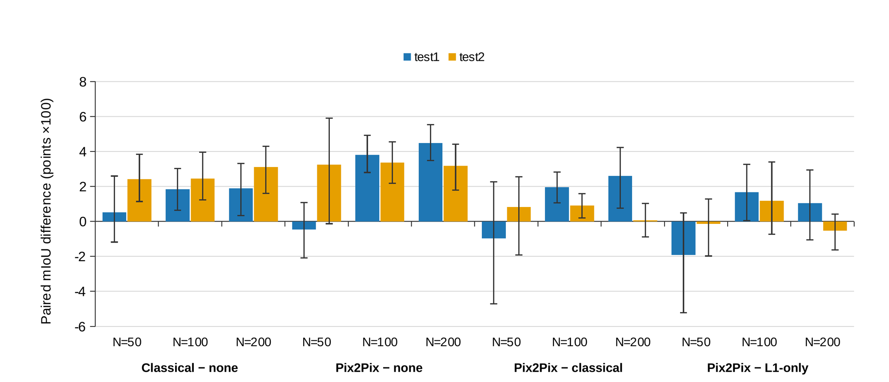

# GeoSEG

**Does generative augmentation help seismic facies segmentation under label scarcity? A step-controlled benchmark on F3.**

[](LICENSE)

Code, configuration and per-checkpoint result tables for a controlled comparison of training-data strategies for seismic facies segmentation on the F3 Netherlands benchmark. The manuscript is in preparation.

The question is narrow. With a fixed segmentation network and a fixed number of optimiser steps, how much does Pix2Pix-generated synthetic data improve a U-Net over no augmentation, over classical seismic augmentation, and over a generator trained without a discriminator (L1-only)?

<p align="center">
  
</p>

## Protocol

| Element | Setting |
|---|---|
| Data | F3 Netherlands, 6 facies; 255 × 255 patches, stride 128; contiguous 15% validation block with a 3-section buffer; two spatially separate test volumes (test1, test2) |
| Label budgets | N = 50, 100, 200 patches (N = 500 as a check), nested within each seed |
| Arms | none, classical (lateral flip, gain, noise, depth shift), Pix2Pix (N real + N synthetic), L1-only generator |
| Training | 1,860 optimiser steps for every arm (step-matched); AdamW, cosine schedule, class-weighted cross-entropy, best-validation checkpoint |
| Networks | U-Net (base 32, Dropout2d) and a DeepLabV3+-style network |
| Metrics | mIoU, pixel accuracy, boundary F1, ECE, NLL, MC-Dropout (T = 50) mutual information, AUROC/AURC of error detection, 5-seed ensembles |
| Statistics | Paired by seed, 95% percentile bootstrap (20,000 resamples), no multiplicity correction |

**Seeds:** five for the step-matched benchmark, three for the fixed-epoch benchmark and the N = 500 checks.

## Results at a glance

Step-matched U-Net, test1 mIoU (mean ± SD over five seeds); full tables are in `results/`.

| Arm | N = 50 | N = 100 | N = 200 |
|---|---|---|---|
| No augmentation | 0.686 ± 0.032 | 0.705 ± 0.010 | 0.712 ± 0.008 |
| Classical | 0.691 ± 0.036 | 0.724 ± 0.014 | 0.731 ± 0.026 |
| L1-only generator | 0.701 ± 0.051 | 0.727 ± 0.018 | 0.746 ± 0.015 |
| Pix2Pix | 0.682 ± 0.045 | 0.743 ± 0.008 | 0.757 ± 0.015 |

<p align="center">
  
</p>

- With 50 labelled patches, seed variance exceeds every effect and no arm can be separated from the baseline.
- At 100 and 200 patches Pix2Pix improves on no augmentation, but classical augmentation delivers part of that gain at no training cost, and the increment of Pix2Pix over classical augmentation depends on the test volume.
- The L1-only generator recovers a large part of the Pix2Pix gain, so the adversarial term contributes little in this setting.
- The Pix2Pix increment over classical augmentation was not reproduced with the second network.
- Equal-epoch comparisons are misleading: the number of updates grows with the budget. The fixed-epoch results are kept only to quantify that confound.

<p align="center">
  
</p>

## Repository layout

```
geoseg/                  core package: config, data, models, augmentation, training, metrics
scripts/                 numbered pipeline, run in order (table below)
analysis/                paired statistics (bootstrap) from the per-checkpoint tables
results/                 summary and per-checkpoint tables (CSV); no weights, no raw data
docs/images/             figures used in this README
```

| Script | Purpose |
|---|---|
| `00_prepare_data.py` | Patch extraction, splits, standardisation |
| `01_fig2_class_imbalance.py` | Class frequencies of the training volume |
| `02_train_pix2pix.py` | Pix2Pix and L1-only generators, one per budget and seed |
| `03_run_experiment_a.py` | Fixed-epoch segmentation training (60 epochs) |
| `04`–`08` | First uncertainty analysis, fixed-epoch figures and diagnostics |
| `09_step_matched_control.py` | Step-matched training of all arms and the N = 500 checks |
| `10_ablation_summary.py` | Paired comparisons including the L1-only arm |
| `11_uncertainty_quality.py` | MC-Dropout, ensembles, ECE, NLL, AUROC, AURC for every checkpoint |
| `12_second_backbone.py` | DeepLabV3+-style network, step-matched |
| `13_stepmatched_illustrations.py` | Example predictions and uncertainty maps for one checkpoint |
| `run_when_free.py` | Waits for free GPU memory, then launches the sweeps |

## Reproducing

```bash
conda create -n geoseg python=3.11 -y && conda activate geoseg
pip install -r requirements.txt            # install the CUDA build of PyTorch for your system
export GEOSEG_DATA_ROOT=/path/to/f3        # folder containing train/ and test_once/
export GEOSEG_RUN_ROOT=/path/for/outputs
python scripts/00_prepare_data.py
python scripts/02_train_pix2pix.py
python scripts/09_step_matched_control.py
python scripts/11_uncertainty_quality.py
python analysis/paired_statistics.py       # regenerates results/paired_*.csv from results/quality_*
```

On Windows PowerShell use `$env:GEOSEG_DATA_ROOT = "..."`. Stages are resumable: a run whose output file exists is skipped.

**Data.** F3 Netherlands is third-party data and is not redistributed. Download it from the [Alaudah et al. (2019) benchmark release](https://github.com/yalaudah/facies_classification_benchmark) or the [Open Seismic Repository](https://opendtect.org/osr/pmwiki.php/Main/NetherlandsOffshoreF3BlockComplete), and respect their licence terms. If your copy has extra folder levels, set `GEOSEG_TRAIN_DIR` and `GEOSEG_TEST_DIR`.

**Hardware.** Results were produced on a single NVIDIA RTX 4500 Ada (24 GB) with PyTorch 2.6.

**Reproducibility notes.**
- Seeds fix the label subset, the initialisation and the generator.
- A data-loader setting (persistent workers) was enabled partway through the study. It changes the order of augmentation random numbers, not their distribution. It applies to the N = 50 L1-only runs, the additional N = 50 seeds, the N = 500 checks and the DeepLab runs.
- `results/quality_test1` and `results/quality_test2` hold per-checkpoint metrics for the 60 step-matched U-Net checkpoints; `results/paired_*.csv` are derived from them by `analysis/paired_statistics.py`.

## Citation

The manuscript is in preparation. Until it appears, please cite the repository (see `CITATION.cff`) and the F3 benchmark:

```bibtex
@article{alaudah2019machine,
  title   = {A machine learning benchmark for facies classification},
  author  = {Alaudah, Yazeed and Micha{\l}owicz, Patrycja and Alfarraj, Motaz and AlRegib, Ghassan},
  journal = {Interpretation},
  volume  = {7},
  number  = {3},
  pages   = {SE175--SE187},
  year    = {2019},
  doi     = {10.1190/INT-2018-0249.1}
}
```

## License

Code is released under the [MIT License](LICENSE). The F3 Netherlands data have their own terms and are not included.

## Acknowledgments

The authors acknowledge the Center for Integrative Petroleum Research and the College of Petroleum Engineering and Geosciences at King Fahd University of Petroleum and Minerals for research support and computational resources.
